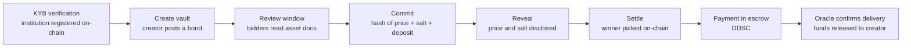

<div align="center">


# Dark Pool

**Compliant sealed-bid auctions for institutional real-world assets, on ADI Chain.**

🏆 **Prize winner at ETHDenver 2026 on the ADI track, selected among 186 projects.**

**[Live demo → dark-pool-five.vercel.app](https://dark-pool-five.vercel.app)** (ADI Testnet)


</div>

---

## The problem

Institutions trading large real-world assets (real estate, private credit, tokenized securities) cannot run auctions on a public order book: every bid is visible, so participants get front-run, copied or undercut. Off-chain sealed-bid processes fix that, but they rely on a trusted intermediary and offer no verifiable audit trail.

## The solution

**Dark Pool** is a sealed-bid auction protocol where:

- **Bids stay hidden** until the auction closes, using a cryptographic commit–reveal scheme.
- **Rules are enforced by smart contracts**: one immutable vault per auction, deterministic winner selection, escrowed payment and collateral.
- **Only vetted institutions can take part**, through an on-chain KYB registry with accreditation, jurisdiction and conflict-of-interest checks.

It is built for **ADI Chain**, an EVM chain designed for regulated institutional finance. Settlement uses an ERC-20 stablecoin (DDSC).

---

## How an auction works



1. **KYB.** An institution submits its KYB application. Once approved, the platform admin calls `verifyInstitution()` on the factory, recording its accreditation status and jurisdiction on-chain.
2. **Create.** An institution holding `BUYER_ROLE` deploys a new `ShadowBidVault` through the factory (EIP-1167 minimal-proxy clone). All parameters are fixed at creation: timing, deposit, whitelisted bidders, allowed jurisdictions, oracle, settlement token and a hash of the asset's legal documents. The creator posts a **bond of 0.5% of the declared asset value** (min 0.01 ADI).
3. **Review.** A review window gives bidders time to inspect the asset documentation before bidding opens.
4. **Commit.** Each bidder signs an **EIP-712 conflict-of-interest attestation**, then submits `keccak256(price, salt, address)` together with a deposit in ADI. Bids can be updated until close.
5. **Reveal.** After close, bidders reveal their price and salt. The contract checks them against the commitment. **Anyone who does not reveal forfeits their deposit.**
6. **Settle.** The creator triggers settlement. The contract picks the winning bid deterministically (lowest revealed price, procurement-style), keeps track of the runner-up and refunds every other deposit.
7. **Pay & deliver.** The winner pays in DDSC into escrow. When the oracle confirms real-world delivery, the payment is released to the creator and any tokenized asset (ERC-721) is transferred to the winner.

---

## Key features

### 🔒 Sealed bidding
- Commit–reveal with a per-bid random salt. Nobody, including the auction creator, can see prices before close.
- Each vault stores the creator's ECIES public key and each commitment a storage-root reference, laying the groundwork for encrypted off-chain bid documents. Encryption and upload are not implemented yet: the storage root is entered manually.
- Bid salts stay in the bidder's browser, with a one-click JSON backup (losing the salt means the bid cannot be revealed).
- Full on-chain audit trail through `getAuditData()`.

### 🏛 Institutional compliance
- **On-chain KYB registry** (`verified`, `isAccredited`, `institutionJurisdiction`) managed by the platform's compliance role.
- **Per-auction restrictions**: bidder whitelist, accredited-investor requirement, allowed jurisdictions (e.g. `UAE`, `KSA`).
- **Conflict of interest**: affiliated addresses are blocked, and every bidder must sign an EIP-712 attestation.
- **Daily re-screening** (Vercel cron) that can revoke an institution's on-chain verification after a sanctions hit.

### 🛡 Settlement safety
- **Creator bond** that the admin or the oracle can slash for fraud (80% to the victim, 20% burned).
- **Payment escrow** in DDSC until the oracle confirms delivery.
- **Second-bidder fallback**: if the winner does not pay in time, their deposit is slashed and the runner-up takes over.
- **Buyer protections**: the winner can dispute a delivery, or reclaim the payment if the oracle never responds (`claimOracleTimeout`).
- **Emergency pause** for compliance incidents, plus a reentrancy guard on every function that moves funds.

### 🤖 AI assistant for bidders and creators
Server-side AI endpoints (`/api/ai/*`) powered by **Groq (Llama 3.3 70B)**, falling back to OpenAI (GPT-4o mini), then Google Gemini (2.0 Flash), then a pure statistical model when no AI provider is available:
RFP generation, lot analysis, bid drafting, bid competitiveness against market data, abnormally-low-bid detection, bid scoring and a post-reveal report.

---

## Architecture

```
┌───────────────────────────── Next.js app (Vercel) ─────────────────────────────┐
│  Landing · Auctions list · Create auction · Auction detail / BidPanel · KYB    │
│                                                                                │
│  API routes:  /api/kyb/*  (Sumsub, on-chain credentialing)                     │
│               /api/ai/*   (Groq → OpenAI → Gemini → statistical fallback)      │
│               /api/cron/rescreen  (daily sanctions re-screening)               │
│                         │                         │                            │
│                    PostgreSQL (Prisma)       wagmi / viem                      │
└─────────────────────────────────────────────────────┼──────────────────────────┘
                                                      │
                        ┌──────────────── ADI Chain ──┴──────────────┐
                        │  ShadowBidFactory                          │
                        │   ├─ KYB registry + roles (AccessControl)  │
                        │   └─ clones ──► ShadowBidVault (1/auction) │
                        └────────────────────────────────────────────┘
```

| Contract | Role |
|---|---|
| [`ShadowBidFactory`](packages/hardhat/contracts/ShadowBidFactory.sol) | Global KYB registry (verification, accreditation, jurisdiction, affiliations), roles (`ADMIN_ROLE`, `BUYER_ROLE`), creates one vault per auction via EIP-1167 clones. |
| [`ShadowBidVault`](packages/hardhat/contracts/ShadowBidVault.sol) | One sealed-bid auction: commit, reveal, settlement, deposits, creator bond, escrow, oracle delivery, fallback and disputes. |
| [`MockERC20`](packages/hardhat/contracts/MockERC20.sol) | Test settlement token standing in for DDSC. |

### Deployed contracts (ADI Testnet, chain ID 99999)

| Contract | Address |
|---|---|
| ShadowBidFactory | [`0xEeeF70011E37EAe0Ec00B70a85Fc7218DF685d3b`](https://explorer.ab.testnet.adifoundation.ai/address/0xEeeF70011E37EAe0Ec00B70a85Fc7218DF685d3b) |
| ShadowBidVault (implementation) | [`0x0271358Aa688Fe130775DcD6E374439B6DB4CF87`](https://explorer.ab.testnet.adifoundation.ai/address/0x0271358Aa688Fe130775DcD6E374439B6DB4CF87) |

---

## Tech stack

| Layer | Tools |
|---|---|
| Smart contracts | Solidity 0.8.30, OpenZeppelin (AccessControl, Clones, EIP712, ECDSA, ReentrancyGuard), Hardhat + hardhat-deploy |
| Frontend | Next.js (App Router), React, TypeScript, wagmi, viem, RainbowKit, Tailwind CSS + DaisyUI |
| Backend | Next.js API routes, Prisma, PostgreSQL, Vercel Cron |
| Compliance | Sumsub (KYB), ComplyAdvantage (sanctions screening) |
| AI | Groq (Llama 3.3 70B), OpenAI and Gemini as fallbacks, statistical fallback |
| Base template | [Scaffold-ETH 2](https://scaffoldeth.io) |

---

## Repository structure

```
packages/
├── hardhat/                  # Smart contracts (current version)
│   ├── contracts/            # ShadowBidFactory, ShadowBidVault, MockERC20
│   ├── deploy/               # hardhat-deploy script (impl + factory, auto-KYB of deployer)
│   ├── deployments/adiTestnet/
│   └── test/ShadowBid.test.ts
└── nextjs/                   # dApp
    ├── app/                  # pages: /, /auctions, /auctions/create, /auctions/[id], /kyb
    │   └── api/              # kyb/*, ai/*, cron/rescreen
    ├── components/darkpool/  # Hero, BidPanel, VaultCard, Countdown…
    ├── components/ai/        # AI widgets
    ├── lib/                  # contracts, Sumsub, sanctions, Prisma
    └── prisma/schema.prisma  # Institution, KybAuditLog
contracts/                    # Earlier hackathon prototype (incl. a 0G ERC-7857 iNFT scoring agent)
```

---

## Getting started

### Requirements
- Node.js ≥ 20.18.3
- Yarn
- PostgreSQL (only for the KYB features)

### Run locally

```bash
yarn install

# terminal 1: local blockchain
yarn chain

# terminal 2: deploy the factory and vault implementation
yarn deploy

# terminal 3: frontend on http://localhost:3000
yarn start
```

The deploy script automatically KYB-verifies the deployer and gives it `BUYER_ROLE`, so you can create an auction right away. To let other wallets take part:

```solidity
factory.verifyInstitution(wallet, /*accredited*/ true, "UAE", "0x"); // allow bidding
factory.grantBuyerRole(wallet);                                       // allow creating auctions
```

> The app targets ADI Testnet by default. To use your local chain, change `targetNetworks` in `packages/nextjs/scaffold.config.ts`.

### Deploy to ADI Testnet

```bash
yarn generate              # or: yarn account:import
yarn deploy --network adiTestnet
```

Then set `NEXT_PUBLIC_FACTORY_ADDRESS` in `packages/nextjs/.env.local`.

### Environment variables

Copy `packages/nextjs/.env.local.example` to `packages/nextjs/.env.local`. The main variables:

| Variable | Purpose |
|---|---|
| `DATABASE_URL` | PostgreSQL connection (KYB records and audit log) |
| `SUMSUB_APP_TOKEN`, `SUMSUB_SECRET_KEY`, `SUMSUB_WEBHOOK_SECRET` | KYB provider. Without them the app runs in **demo mode** (`/api/kyb/demo-approve`). |
| `COMPLY_ADVANTAGE_API_KEY` | Sanctions screening (skipped in demo mode) |
| `PLATFORM_ADMIN_PRIVATE_KEY`, `FACTORY_CONTRACT_ADDRESS`, `NEXT_PUBLIC_FACTORY_ADDRESS` | Server-side on-chain credentialing of approved institutions |
| `GROQ_API_KEY` | AI features (primary provider). `OPENAI_API_KEY` and `GEMINI_API_KEY` are optional fallbacks. |
| `CRON_SECRET` | Protects `/api/cron/rescreen` |

### Tests

```bash
yarn hardhat:test
```

The suite (`packages/hardhat/test/ShadowBid.test.ts`, 41 tests) covers KYB gating, commit–reveal, deposit slashing, settlement, bonds, escrow, oracle flows and the second-bidder fallback.

---

## Security notes

An internal audit (November 2026) identified design issues in the **deployed** contracts. They are acceptable for a testnet demo but must be addressed before any real use:

- **Trust model:** the auction creator is set as the vault's admin and chooses its oracle, so the escrow, bond slashing and pause can be controlled by the creator.
- **Economic model:** the lowest revealed price wins, yet the winner pays the creator. The protocol needs to commit to either a sale (highest bid wins) or a procurement flow (creator pays the winner).
- **Liveness:** only the creator can call `settle()`, and an auction where nobody reveals cannot be settled or cancelled, so deposits can get stuck.
- ERC-20 transfers are unchecked, refunds are pushed in loops (one reverting recipient blocks settlement), and revoking an institution does not remove `BUYER_ROLE`.

Already mitigated in the web app: KYB demo endpoints require a wallet signature, are idempotent and capped per IP and per day (they spend the admin wallet's gas), and AI endpoints are rate-limited per IP with a global daily cap.

## Team

Built at ETHDenver 2026 by [@jojo2504](https://github.com/jojo2504), [@bilfrux](https://github.com/bilfrux) and [@wilivms](https://github.com/wilivms).

Original repository: [jojo2504/dark-pool](https://github.com/jojo2504/dark-pool).

## License

MIT. Built on [Scaffold-ETH 2](https://github.com/scaffold-eth/scaffold-eth-2) by BuidlGuidl.
